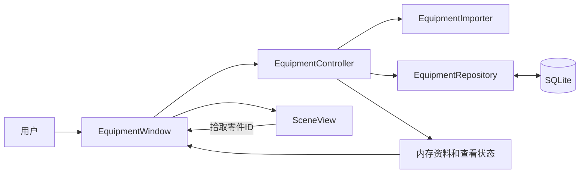

# 设备模型查看器 0.2 技术导读

2026-10-08，依据实际实现。实际工程：D:/作业/简历/工作模拟。用户操作见使用说明，编码与协作要求见工程规范。

## 模块与数据流

Window 显示界面并传递操作；Controller 是当前设备、选中ID和隐藏集合的来源。Repository 不操作窗口；Importer 只负责校验转换；SceneView 不读数据库。

## 实际入口

- src/main.cpp：参数、数据库初始化和窗口生命周期；--equipment-view 打开设备界面，默认仍保留原记录示例。
- src/equipmentimporter.cpp：JSON格式、字段类型、数量及几何校验。先构造局部完整结果，失败不改输出。
- src/equipmentrepository.cpp：STRICT结构、参数绑定、事务保存、读取及回滚；原F01数据库实现保留。
- src/equipmentcontroller.cpp：完整加载后替换状态，按内存ID选择，隐藏/隔离/显示全部，以及导入保存与打开。
- src/equipmentwindow.cpp：设备选择、5MiB文件读取、搜索、属性字段清空/切换，信号阻塞与选择恢复。
- src/sceneview.cpp：归一化box/cylinder几何、相机、投影面拾取、OpenGL深度绘制和软件回退。

## 三条业务链路

选择：清单Qt::UserRole中的ID → Controller.selectPart → selectedPart借用当前内存对象 → Window同步属性与Scene高亮。点击不重查SQL，借用指针不跨重新加载保存。

导入：窗口读取有限大小文件 → Controller调用Importer完整解析 → Repository事务保存全部资料 → 重新加载设备 → 更新设备选择、清单、属性和场景。重复设备拒绝覆盖；提交成功后读取失败提示已保存但无法打开，不能误导用户重复导入。

显隐：Controller维护hiddenPartIds → Window标记隐藏清单项 → Scene接收同一集合。隐藏不清选择；显示全部恢复所有零件。搜索只过滤清单，过滤掉选中项时清选择，不改变隐藏集合。

## 图形与生命周期

数据单位毫米、Z向上、圆柱沿X，位置为几何体中心。先用有限值缩放再计算包围盒，避免极端值加减溢出。Scene拷贝几何，不持有Controller的Part指针。

原生路径使用OpenGL着色器、VBO和深度缓冲；offscreen/minimal或图形初始化失败使用软件投影。软件平均深度排序对相交几何有精度限制。拖动阈值区分旋转与拾取。

GPU资源在有效上下文中清理；清理先断开上下文销毁连接，避免派生类成员析构后基类发信号调用已失效成员。场景子控件在PImpl数据析构前释放。

## 验证与恢复

九项CTest覆盖环境、原记录、持久化、属性、导入、场景、完整工作流和两种窗口启动。原生图形单独运行验证，不能用offscreen替代。独立审查对应实际文件与功能提交8ebe748；真实用户体验尚未验收。

恢复先读AGENTS、docs/working-state.md和handoffs，再查实际Git状态。基线cbc879f与功能8ebe748为本地检查点；数据库快照在忽略的.recovery/databases。Git不恢复运行数据库，普通数据库复制前关闭所有使用程序。

## 后续修改入口

变更JSON规则看Importer；变更资料保存看Repository；变更选择/显隐语义看Controller；变更界面、搜索和属性看Window；变更几何/相机/拾取看Scene。接口或行为调整同步规范、指南与验证，不把旧检查结果沿用到新代码。
