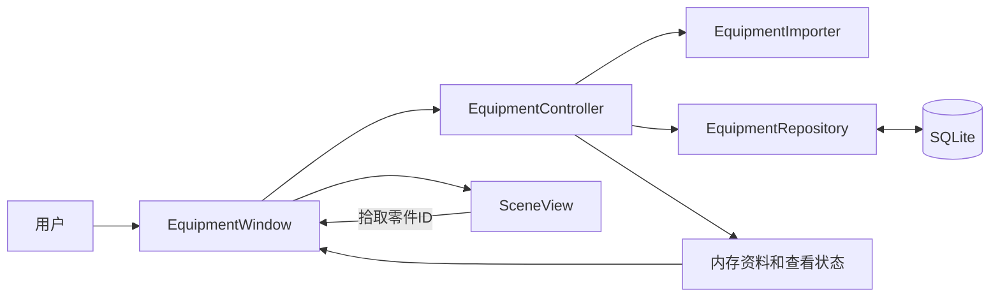

# 设备模型查看器技术导读

2026-10-08，依据实际实现。实际工程：D:/作业/简历/工作模拟。用户操作见使用说明，编码与协作要求见工程规范。

> 版本提示（2026-10-11）：本文描述的是 1.1.1 历史实现（根目录 `src/`、`api/`）。1.2.0 起正式实现
> 迁到 `refactor/`，并整体移除了“团队共享库/工艺批注”，因此下文 HTTP 共享与批注链路的模块、
> 文件与接口对当前版本不再适用（历史实现见 Git 标签 `v1.1.1`）。当前实现导读见
> `refactor/docs/package/02-技术说明.md`。

## 模块与数据流

Window 显示界面并传递操作；Controller 是当前设备、选中ID和隐藏集合的来源。Repository 不操作窗口；Importer 只负责校验转换；SceneView 不读数据库。

## 实际入口

- src/main.cpp：参数、数据库初始化和窗口生命周期；--equipment-view 打开设备界面，默认仍保留原记录示例。
- src/equipmentimporter.cpp：JSON格式、字段类型、数量及几何校验。先构造局部完整结果，失败不改输出。
- src/equipmentrepository.cpp：STRICT结构、参数绑定、事务保存、读取及回滚；原F01数据库实现保留。
- src/equipmentcontroller.cpp：完整加载后替换状态，按内存ID选择，隐藏/隔离/显示全部，以及导入保存与打开。
- src/equipmentwindow.cpp：设备选择、5MiB文件读取、搜索、属性字段清空/切换，信号阻塞与选择恢复。
- src/sceneview.cpp：归一化box/cylinder几何、相机、投影面拾取、OpenGL深度绘制和软件回退。

## 三条业务链路

选择：清单Qt::UserRole中的ID → Controller.selectPart → selectedPart借用当前内存对象 → Window同步属性与Scene高亮。点击不重查SQL，借用指针不跨重新加载保存。

导入：窗口读取有限大小文件 → Controller调用Importer完整解析 → Repository事务保存全部资料 → 重新加载设备 → 更新设备选择、清单、属性和场景。重复设备拒绝覆盖；提交成功后读取失败提示已保存但无法打开，不能误导用户重复导入。

显隐：Controller维护hiddenPartIds → Window标记隐藏清单项 → Scene接收同一集合。隐藏不清选择；显示全部恢复所有零件。搜索只过滤清单，过滤掉选中项时清选择，不改变隐藏集合。

## 图形与生命周期

数据单位毫米、Z向上、圆柱沿X，位置为几何体中心。先用有限值缩放再计算包围盒，避免极端值加减溢出。Scene拷贝几何，不持有Controller的Part指针。

原生路径使用OpenGL着色器、VBO和深度缓冲；offscreen/minimal或图形初始化失败使用软件投影。软件平均深度排序对相交几何有精度限制。拖动阈值区分旋转与拾取。

GPU资源在有效上下文中清理；清理先断开上下文销毁连接，避免派生类成员析构后基类发信号调用已失效成员。场景子控件在PImpl数据析构前释放。

## 验证与恢复

当前测试目标和运行结果以CMakeLists.txt与docs/releases中的逐版记录为准。原生图形单独运行验证，不能用offscreen替代。真实用户体验与技术、模拟验收分别记录。

恢复先读AGENTS、docs/working-state.md和handoffs，再查实际Git状态。基线cbc879f与功能8ebe748为本地检查点；数据库快照在忽略的.recovery/databases。Git不恢复运行数据库，普通数据库复制前关闭所有使用程序。

## 后续修改入口

变更JSON规则看Importer；变更资料保存看Repository；变更选择/显隐语义看Controller；变更界面、搜索和属性看Window；变更几何/相机/拾取看Scene。接口或行为调整同步规范、指南与验证，不把旧检查结果沿用到新代码。

## HTTP共享与批注链路（0.4/0.5）

EquipmentWindow打开拥有独立ApiClient的CollaborationDialog。Qt Network异步传输；每个回复在完成、失败或取消后回收。ApiClient的generation拦截取消前排队成功结果；Dialog的operation拦截旧操作回调，防止新请求的busy状态被旧请求清除。

发布：Controller当前完整设备→JSON→Bearer HTTP→Node严格校验→MySQL事务保存设备与全部零件。下载：HTTP详情→Importer完整验证→本地SQLite事务保存→Controller重新加载。几何不可变、重复ID拒绝覆盖，本地失败保留资料。

批注：精确equipmentId+partId/null查询→列表当前DTO和只读保存内容→独立草稿→显式POST/PUT。POST使用UUID与原始payload指纹，同一原请求重试返回当前存续DTO；PUT带expectedRevision，单条CAS更新，旧版本409并保留草稿。刷新只更新保存DTO和修订，不自动提交。作者显示名不是独立账号认证；DTO时间为UTC。

修改失败保护看src/collaborationdialog.cpp；网络生命周期看src/apiclient.cpp；HTTP鉴权/大小/截止看api/src/server.mjs；MySQL事务/结构迁移看api/src/repository.mjs；批注字段与指纹看api/src/annotations.mjs。客户端不持有MySQL密码，配置不上传。

MySQL迁移从验证通过的v1增建annotations，再验证结构并更新schema marker；DDL可能隐式提交，中断后重入，不靠删除数据升级。执行前保存独立一致性备份。源代码回退不能撤销数据迁移，恢复必须单独验证。

## STEP与网格链路（0.8）

Window.importFile按扩展名分流 → CadImportProcess启动显式私有Python及OCP转换器 → 受限结果文件 → CadResultParser完整校验 → Controller调用Repository事务保存 → 重新加载内存和Scene。转换等待异步；Windows自有Job从进程创建时附加内存和退出约束，确认全部子孙结束再消费结果/清理目录。未知退出状态保留忙状态和临时资料，取消可重试。

tools/cad/convert_step.py检查整份拓扑，拒绝独立开放几何，累计装配变换并转换毫米。meshgeometry.cpp校验局部顶点、三角索引与真实引用包络；EVM1二进制保存不可变网格。Repository先读长度和头部核累计预算，再读取BLOB，避免很多合法大网格使进程无界占用。已知旧SQLite结构事务迁移并核对行数、外键和完整性；未知结构报错保留。

Scene以position+localVertex画真实三角面，并复用毫米标尺、拾取与显隐。共享std::shared_ptr<const MeshGeometry>不借用可失效Part。CAD本地发布明确拒绝，旧HTTP基础几何契约继续有效。私有运行库准备见tools/cad/setup_runtime.py；构建/交付复制由scripts/sync-cad-runtime.ps1执行，第三方许可随包保存。

## 1.1显示状态与持久资料边界

SceneView的视图、轴位置、颜色、展开和单件拉远只影响内存绘制；displayOffset为毫米副本，原始Part/网格不回写Repository。Controller仍是选中/隐藏/隔离来源，取消选中不清隔离；Window把有效ID、显隐和查看操作传给Scene，并分别展示原位置与显示偏移。设备成功切换清展示状态，失败保旧设备与显示，网络批注保既有API契约。

两条原生绘制路径共用归一化/相机/拾取约定。软件回退检查与原生OpenGL FBO验证分列，多视图拾取按对应子视口转换，而不是沿用整画布NDC。资源按原Qt/GL上下文生命周期释放。当前实现与验证门槛见releases/1.1.md。
