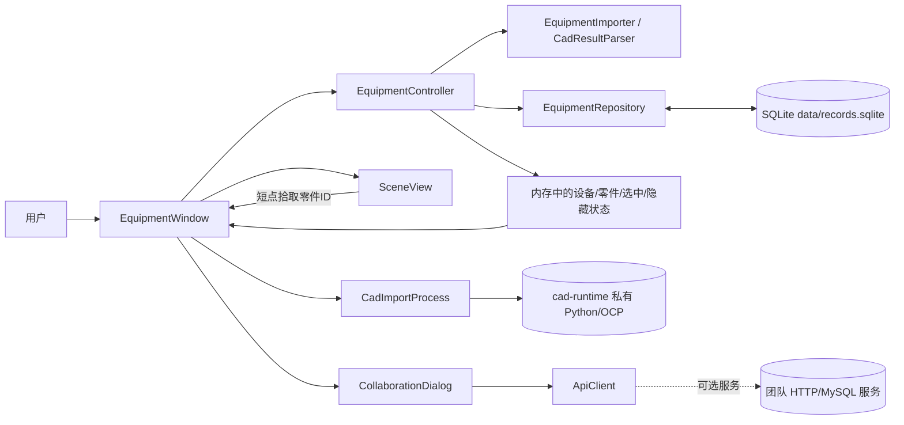

# 设备模型查看器 · 技术说明

读者：需要理解、二次开发或评审本程序的开发者。
版本：1.1.1（去重重构构建，源码树 `refactor/src`）。日期：2026-10-11。
状态：构建、自动检查与原生图形验收均通过（证据见 [03-验证记录.md](03-验证记录.md)）；未做跨机器与长期运行验证。

## 1. 技术栈与环境

| 项目 | 版本 | 用途 |
| --- | --- | --- |
| 语言标准 | C++17 | 全部实现 |
| Qt | 6.11.1 MinGW 64 位（Core/Widgets/Sql/OpenGL/OpenGLWidgets/Network/Test） | 界面、数据库、网络、OpenGL 上下文 |
| 编译器 | GCC 13.1.0（MinGW-w64，非 MSVC） | 编译链接 |
| 构建 | CMake 3.30.5 + Ninja 1.12.1 | 配置与构建 |
| 数据库 | QSQLITE（SQLite 3.53.0） | 本地设备资料 |
| CAD 转换 | 私有 Python 3.14 embed + OCP 7.9.3.1（`cad-runtime`） | STEP/STP → 闭合实体三角网格 |

构建依赖（只在开发机需要）与运行依赖（交付文件夹里必须存在）分开：

| 类别 | 必需内容 |
| --- | --- |
| 构建依赖 | Qt 6.11.1 MinGW 套件、GCC、CMake、Ninja；构建 STEP 导入还需私有 CAD 运行库 |
| 运行依赖 | `设备查看器.exe`、同目录 `Qt6*.dll` 与 MinGW 运行库、`platforms\qwindows.dll`、`sqldrivers\qsqlite.dll`、其余插件目录；STEP 导入额外需要 `cad-runtime\` |

## 2. 目录结构

交付目录（本文件夹）只含运行文件；源码目录在开发工程的 `refactor\` 下：

| 交付目录内容 | 对应的源码位置 |
| --- | --- |
| `设备查看器.exe` | 由 `refactor/src` 构建的 `qt_sqlite_demo` 目标重命名 |
| `Qt6*.dll`、插件目录 | 由 `windeployqt` 部署，脚本 `refactor/build.ps1` |
| `cad-runtime\` | 由 `scripts/sync-cad-runtime.ps1` 同步自 `.runtime/cad-distribution/cad-runtime` |
| `samples\` | 工程根目录 `samples\`（虚构 JSON + 公开 STEP 样例与许可） |
| `文档\` | `refactor/docs/package/` 与 `refactor/docs/dedup-report.md` |
| `manifest.json` | 由 `refactor/package.ps1` 生成（版本、提交、文件数、exe 哈希） |

源码目录（`refactor/src`）文件与职责：

| 文件 | 职责 |
| --- | --- |
| `main.cpp` | 参数解析、资料库准备、默认打开设备查看器、窗口生命周期 |
| `equipmentwindow.*` | 设备选择、零件清单与搜索、只读属性、导入入口、状态提示；不写 SQL |
| `equipmentcontroller.*` | 当前设备、零件、选中、隐藏与隔离状态的唯一来源 |
| `equipmentrepository.*` | SQLite 结构校验与迁移、参数绑定事务保存、读取与回滚；不操作界面 |
| `equipmentimporter.*` | JSON 严格校验并转换为数据对象；失败不改变调用方输出 |
| `cadresultparser.*` | CAD 转换结果协议 v1 的严格校验（EVM1 网格与包络） |
| `cadimportprocess.*` | 受控启动私有 Python 转换进程、Job 约束、超时/取消/退出确认 |
| `meshgeometry.*` | 网格拓扑校验与 EVM1 二进制编解码 |
| `sceneview.*` | 三维几何生成、相机、拾取、OpenGL 绘制与软件回退、视图/展开/配色显示状态 |
| `collaborationdialog.*`、`apiclient.*` | 团队共享库与工艺批注的 HTTP 客户端（可选服务） |
| `recordstore.*`、`mainwindow.*` | 保留的旧“记录示例”功能 |
| `numericutil.h`、`partvalidation.h`、`jsonutil.h`、`sqliteconnection.h` | 去重重构抽出的共用实现（见 [04 文档](04-重复实现审查与去重报告.md)） |

## 3. 模块与数据流（实际实现）



三条主要链路：

| 链路 | 步骤 | 关键约束 |
| --- | --- | --- |
| 选择 | 清单按 ID → `Controller.selectPart` → 借出内存零件 → 属性与三维高亮同步 | 点击不重查数据库；借出的指针不跨重新加载保存 |
| 导入 | 窗口读取受限文件 → 解析器完整校验 → 仓库事务保存全部资料 → 重新加载 → 更新界面 | 重复设备 ID 拒绝覆盖；保存成功但读取失败时必须说明“已保存”，不能误导重复导入 |
| 显隐 | `Controller` 维护隐藏集合与隔离状态 → 清单标记 → 场景接收同一集合并排除拾取 | 隐藏不清选择；显示全部清除隔离并保留选择；搜索只过滤清单 |

## 4. 三维实现要点

- 数据单位毫米、Z 向上、圆柱沿 X；几何体中心为 `position`。几何先归一化再求包围盒，避免极端数值加减溢出。
- 两条绘制路径共用同一套归一化、投影与光照约定：有原生上下文时用 OpenGL（VBO + 深度缓冲），`offscreen/minimal` 或上下文创建失败时回退到画家排序的软件投影，并在 `rendererDescription()` 中如实报告当前路径。
- 曲面着色与网页版一致：三角面三个角点各自带顶点法线——长方体等平面按面法线（硬边保持分面），圆柱侧面用半径方向的解析法线，STEP 网格按共享顶点累加相邻面法线（夹角超过 50° 的硬边仍用面法线）；光照 = 半球环境光 + 单向漫反射，全部乘性计算。原生路径按角点上传颜色做逐顶点插值（Gouraud），因此曲面相邻三角面之间是连续渐变，不再出现逐面片台阶。
- 原生路径把三维绘制放进自建帧缓冲：请求 4 倍多重采样，并按“每个逻辑像素至少 2×2 个渲染像素”的超采样目标（受 8192 纹理尺寸与 2.5 倍上限约束）解析回控件帧缓冲；实际采样数取自本次绘制 FBO 并写入渲染描述，不按请求值宣称。
- 参考网格是**受限地面网格**：步长按模型毫米尺度取 1/2/5 档，每族最多 29 条（合计 ≤58 条），范围随可见几何收敛；正视图/右视图下地面与视线平行时不绘制。
- 方向轴（右下角与模型旁）按网页版同一规则投影：端点 = 原点 + 世界轴在相机空间的**真实投影** × 半径（角落 39 像素圆点轴、模型旁 55 像素箭头），**不做归一化**——轴接近视线方向时长度自然压到零，只留圆点与字母，因此不会出现固定长度、方向在 0°/180° 之间跳变的现象；字母贴在端点右上方，按相机空间深度排序（近处的轴最后画）；三视图每一栏使用本栏视线计算，不共用首栏朝向。几何由 `SceneView::axisGizmo()` 与绘制共用同一份计算，验收直接读取该几何并核对画布像素。
- 视图模式包括彩色装配、工程轴测、二维正交与三视图；三视图各栏使用同一像素/毫米比例，并各自做子视口拾取。
- 视图、坐标轴位置、颜色、展开与单件拉远只改变内存中的显示状态：`displayOffset` 是毫米副本，原始零件与网格不回写资料库。

## 5. 去重重构

本轮重构在原工程之外新建 `refactor/`，消除 18 类重复实现，抽象出 4 个共用内部头文件，公开类与公开接口签名、对象名、用户可见文案保持不变。逐条证据、未处理的残留项与重复度数据见 [04-重复实现审查与去重报告.md](04-重复实现审查与去重报告.md)。

本轮同时新增了打包用的界面改动：默认入口改为设备查看器（旧记录窗口保留为 `--record-view`），并加入应用图标（`refactor/resources/app.ico`，由 `refactor/tools/make_icon.py` 生成，`app.rc` 嵌入 EXE、`app.qrc` 供窗口与任务栏使用）。

## 6. 构建与打包

在开发工程根目录执行（工具链参数与工程内 `scripts/build.ps1` 相同，只把源码目录指到 `refactor`）：

```powershell
# 配置 + 构建 + 部署 Qt 运行库 + 同步 CAD 运行库 + 全量 CTest
.\refactor\build.ps1

# 生成交付目录（示例：本文件夹）
.\refactor\package.ps1 -OutputRoot 'D:\作业\简历\cad查看器' -BuildDirectory build-refactor

# 重新生成嵌入式图标（改动图标设计后）
python .\refactor\tools\make_icon.py
```

`package.ps1` 只复制运行所需文件，不复制源码、测试程序、`data` 数据库与本机凭证；脚本会拒绝写入非本脚本生成的目录，除非显式加 `-Force`；打包末尾用 `-platform offscreen --smoke-test` 在交付目录内实际启动一次并截图验证。

## 7. 已知限制与未验证项

- 未在其它 Windows 版本、其它 Qt 版本、无 Qt 环境的干净机器上做过安装级验证；本机验证使用已部署的运行库（与交付目录一致）。
- 软件回退路径的遮挡精度低于深度缓冲；相交几何在软件路径下可能有排序误差。
- 大型装配（十万级三角以上）的交互流畅度、长时间运行的内存表现未做量化验证。
- 团队共享库/批注服务不在本交付内；相关代码保留但未在本机启用。
- 显示偏移、展开与单件拉远是演示用视觉效果，不验证机械运动或碰撞约束；尺寸读数为全局外包络，不是制造标注。
